# LLM Wiki Assistant

En este repositorio se conectan los servicios de Moodle, Matrix, Git, y una API para obtener métricas de las interacciones de los estudiantes con LLMs.

## Índice
- [Tecnologías usadas](#tecnologías-usadas)
- [Diagramas de interacción](#diagramas-de-interacción)
  - [1. Creación de curso y repositorio oficial](#1-creación-de-curso-y-repositorio-oficial)
  - [2. Creación de sala Matrix y repositorio del alumno](#2-creación-de-sala-matrix-y-repositorio-del-alumno)
  - [3. Autenticación en Element contra Moodle](#3-autenticación-en-element-contra-moodle)
  - [4. Consulta en el chat y respuesta asistida (RAG)](#4-consulta-en-el-chat-y-respuesta-asistida-rag)
  - [5. Anonimización PII, cifrado en Vault y guardado en Git](#5-anonimización-pii-cifrado-en-vault-y-guardado-en-git)
  - [6. Métricas y auditoría de discrepancias](#6-métricas-y-auditoría-de-discrepancias)
  - [7. Autenticación en el Dashboard Frontend](#7-autenticación-en-el-dashboard-frontend)
  - [8. Generación de resúmenes evaluativos con IA](#8-generación-de-resúmenes-evaluativos-con-ia)
- [Estructura del Proyecto](#estructura-del-proyecto)
  - [Raíz](#raíz)
  - [Directorios Globales](#directorios-globales)
  - [Código Fuente (`src/`)](#código-fuente-src)
- [Guía de Instalación Paso a Paso](#guía-de-instalación-paso-a-paso)
  - [Generación de Documentación (Doxygen)](#generación-de-documentación-doxygen)

---

## Tecnologías Usadas
| Capa | Servicio | Tecnologías | Función |
| --- | --- | --- | --- |
| Plataforma educativa | `moodle` | Moodle (Bitnami), PHP 8.3, MariaDB 10.11 | Cursos y usuarios; el bloque `block_bdc` crea la sala y el repositorio de cada alumno |
| Chat | `synapse`, `element` | Matrix Synapse, Element Web, nginx | Servidor y cliente web de chat; el login se valida contra Moodle |
| Bot | `maubot`, `sync-worker-1/2` | Maubot, Python, httpx, asyncpg, RQ | Responde en las salas, sincroniza repositorios y registra interacciones |
| Búsqueda semántica | `pgvector` | PostgreSQL 16 + pgvector | Almacén de *embeddings* de los apuntes |
| Cola de tareas | `redis` | Redis 7 (AOF), RQ | Trabajos en segundo plano y bloqueos distribuidos |
| API de mapeo | `mapeo-api` | Python 3.11, FastAPI, SQLAlchemy, Alembic, Pydantic | Relación Alumno ↔ Git ↔ Matrix; crea repositorios y colaboradores |
| Base de datos | `postgres` | PostgreSQL 16 | Datos de mapeo, métricas y Synapse |
| API de métricas | `metrics-api` | FastAPI, SQLAlchemy, Alembic, PyJWT, Fernet (cryptography) | Métricas, login con JWT, rúbricas, agente evaluador y vault de PII |
| Auditoría | `metrics-worker` | Python asyncio, httpx | Contrasta el historial de Git con la base de datos |
| Dashboard | `frontend` | React 19, TypeScript, Vite, Recharts, React Router | Panel del profesorado |
| Privacidad | `sync_worker/pii_guard` | Presidio, spaCy (`es_core_news_lg`, `en_core_web_lg`) | Pseudonimiza datos personales antes de guardar los logs |
| Control de versiones | — | GitHub, GitLab o Git autoalojado | Repositorio por alumno y repositorio oficial por asignatura |
| Modelos de lenguaje | — | OpenAI-compatible, Gemini, Ollama (opcional) | Respuestas del bot y resúmenes del agente evaluador |
| Copias de seguridad | `backup` | Alpine, cron, `pg_dump` | Copia diaria a las 03:00 |
| Infraestructura | — | Docker, Docker Compose, Bash | Despliegue con `instalar.sh` |
| Tests | — | pytest, respx, Playwright | Pruebas unitarias, de integración y e2e |
---


## Diagramas de interacción

A continuación se presentan los diagramas de secuencia que describen el flujo de interacción entre los diferentes microservicios y usuarios de la plataforma:

### 1. Creación de curso y repositorio oficial
Profesor o administrador crea un nuevo curso en Moodle.

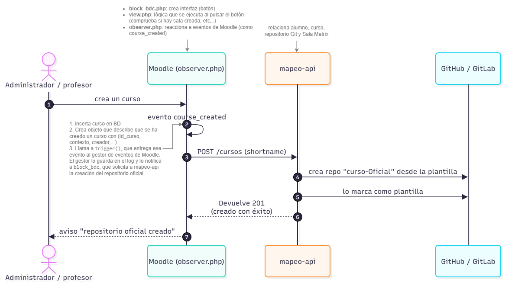

---

### 2. Creación de sala Matrix y repositorio del alumno
Cuando el estudiante interactúa por primera vez con el bloque de Moodle.

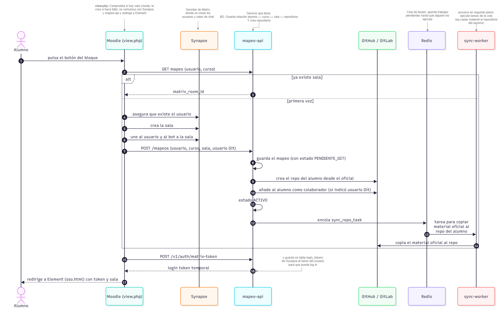

---

### 3. Autenticación en Element con Moodle
Al acceder desde Moodle a Element, se autentica al usuario en Element.

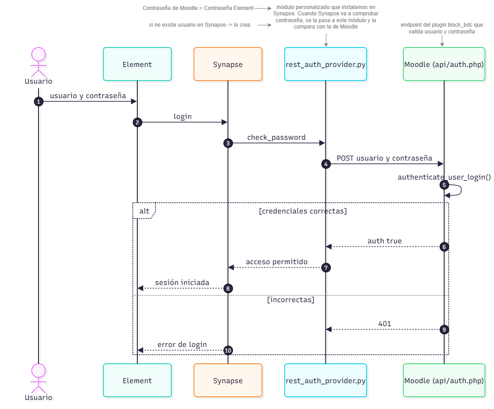

---

### 4. Consulta en el chat y respuesta asistida (RAG)

Flujo de cuando el usuario interactua con el bot o realiza una consulta.

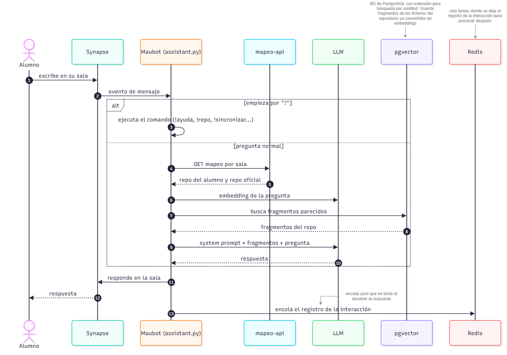

---

### 5. Anonimización PII, cifrado en Vault y guardado en Git

Mecanismo de protección de la privacidad que anonimiza datos personales.

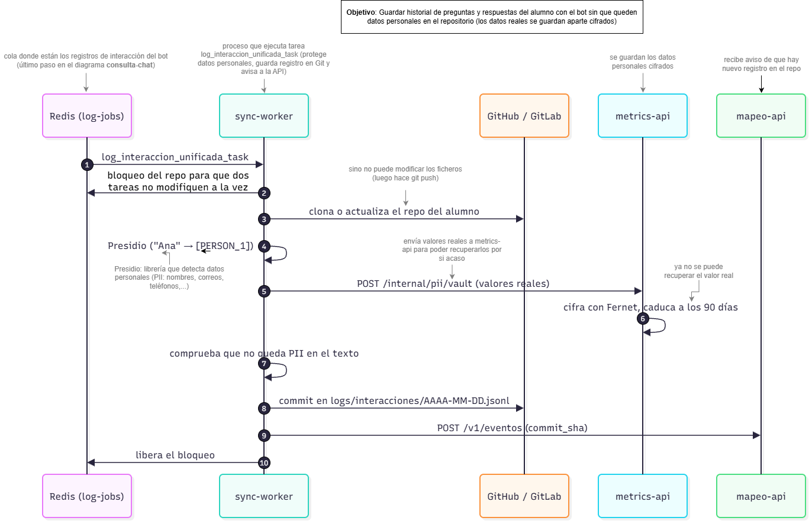

---

### 6. Métricas y auditoría de discrepancias
Proceso en segundo plano para manejar las métricas (asegurándose que esté todo sincronizado)

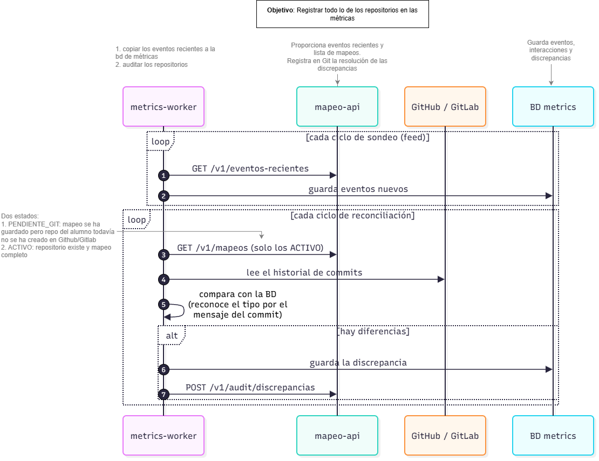

---

### 7. Autenticación en el Dashboard Frontend
Inicio de sesión y validación de ser profesor. Muestra las métricas de los cursos del profesor.

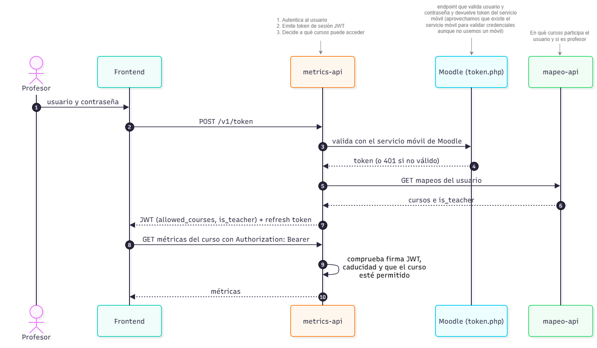
---

### 8. Generación de resúmenes de un curso

Profesor solicita un resumen general del curso (teniendo en cuenta las interacciones de sus alumnos con el chat).

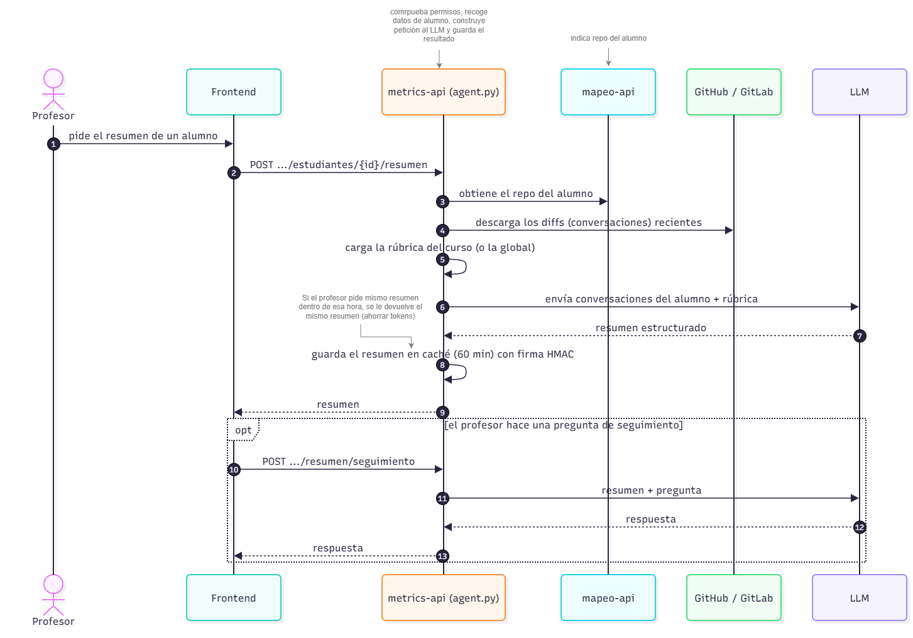

---

## Estructura del Proyecto

### Raíz
- **`docker-compose.yml`**: Levanta todos los microservicios juntos (Bases de datos, APIs, Bots, Frontend, etc.).
- **`.env.example`**: Plantilla de variables de entorno donde se definen las contraseñas, tokens y configuración.
- **`instalar.sh`**: Script que ejecutará todo el proyecto desde cero, generando el entorno y documentación.

### Directorios Globales
- **`config/`**: Contiene la configuración del proyecto que no sea sensible (por ejemplo los enlaces y puertos de cada servicio).
- **`docs/`**: Documentación del proyecto.
- **`scripts/`**: Scripts auxiliares.
- **`tests/`**: Tests del proyecto

### Código Fuente (`src/`)
Contiene los distintos microservicios:

* **Servicios Core (Infraestructura Base)**
  * **`moodle/`**: Código y configuración de Moodle, incluyendo el plugin personalizado (`block_bdc`).
  * **`matrix/`**: Configuración de Synapse (servidor Matrix) y Element (cliente web de chat).
  * **`bot/`**: Código fuente de *Maubot* (el bot de chat de Matrix) y de los *sync-workers* encargados de sincronizar en segundo plano el material con GitHub.
  * **`api/` (mapeo-api)**: API para el mapeo de los usuarios y sus gits (Alumno <-> Git <-> Matrix).
  * **`shared/`**: Paquetes y librerías de Python compartidas entre múltiples servicios para no repetir código.
  * **`backup/`**: Microservicio con un Cron que realiza copias de seguridad de las bases de datos.

* **Servicios de Trazabilidad (Analítica y Métricas)**
  * **`metrics-api/`**: API para manejar las interacciones de los alumnos con los LLMs.
  * **`metrics-worker/`**: Proceso en segundo plano para evitar discrepancias de la base de datos con git.
  * **`frontend/`**: Dashboard para que los profesores consulten las métricas de los alumnos.

---

## Guía de Instalación Paso a Paso

1. **Clonar y Entrar al Repositorio:**
   ```bash
   cd llm-wiki-assistant-unificado
   ```

2. **Preparar la Configuración:**
   Copia las plantillas de configuración a sus respectivos archivos finales:
   ```bash
   cp .env.example .env
   cp config/config.yaml.example config/config.yaml
   ```

3. **Configurar Variables de Entorno (`.env`) y Configuración Global (`config.yaml`):**
   - Abre el archivo `.env` recién creado y rellena los valores marcados como `[CAMBIAR]`.
   - **Token de GitHub:** El PAT clásico de GitHub debe tener el scope **`repo`** completo. Ponlo en `GITHUB_PAT`.
   - Abre `config/config.yaml` y define tu proveedor Git activo (`git.proveedor_activo`, ej. `github`).
   
   #### Configuración para Proxy Inverso (Producción)
   Variables a cambiar si se usa proxy inverso:

   * **`DOMAIN`**: Tu dominio base (ej. `mi-dominio.com`).
   * **`MOODLE_REVERSEPROXY_ENABLED`**: Cámbialo a `yes` para que Moodle sepa que está detrás de un proxy y genere bien las redirecciones.
   * **`MOODLE_EXTERNAL_URL`**: La URL pública de Moodle. Ej: `https://${DOMAIN}` (sin puerto).
   * **`ELEMENT_URL_BASE`**: La ruta pública donde vas a servir el cliente de chat Element. Ej: `https://${DOMAIN}/element` o `https://element.${DOMAIN}`.
   * **`MAUBOT_PUBLIC_URL`**: La URL pública para el panel web del bot. Ej: `https://${DOMAIN}/maubot` o `https://maubot.${DOMAIN}`.
   * **`FRONTEND_URL`**: La URL pública del dashboard de métricas de trazabilidad. Ej: `https://${DOMAIN}/trazabilidad` o `https://trazabilidad.${DOMAIN}`.
   * **`VITE_ALLOWED_HOSTS`**: Si el dashboard (Frontend) se sirve bajo un nombre de dominio concreto, añádelo aquí (ej. `trazabilidad.mi-dominio.com`) para que el servidor permita la conexión.
   * **`VITE_HMR_PORT`**: Descomenta y ajusta esta variable si usas Vite con un puerto público diferente al interno (ej. `443` para HTTPS).

   > **Nota:** Las URLs internas de Element (`config.json`) y Maubot (`config.yaml`) se actualizan automáticamente al ejecutar `./instalar.sh`. No es necesario editarlas a mano.

4. **Configurar y levantar los servicios:**
   Ejecuta el script de instalación principal:
   ```bash
   ./instalar.sh
   ```
   > **Diferencia entre `./instalar.sh` y `./instalar.sh up`:**
   > - `./instalar.sh` (sin argumentos) ejecuta la instalación completa: genera secretos en el `.env`, inyecta variables en las plantillas de configuración, levanta Docker Compose, auto-registra a los usuarios en Matrix, extrae los tokens necesarios y finalmente empaqueta el plugin de Maubot.
   > - `./instalar.sh up` ejecuta todo lo anterior, **excepto** la fase de empaquetado del plugin del bot. Usa `up` si solo quieres levantar la infraestructura sin recompilar el `.mbp`.

5. **Configurar el Bot (Maubot):**
   - Accede a la interfaz de administración de Maubot en `http://localhost:29317/_matrix/maubot/` (o el `MAUBOT_PUBLIC_URL` que hayas configurado). Usuario `admin`, contraseña `MAUBOT_ADMIN_PASSWORD` del `.env`.
   - Sube el plugin del bot (empaquetado como `.mbp`) en la pestaña **Plugins**. El plugin compilado se encuentra en `src/bot/llm-wiki-assistant-plugin/plugin.mbp`.
      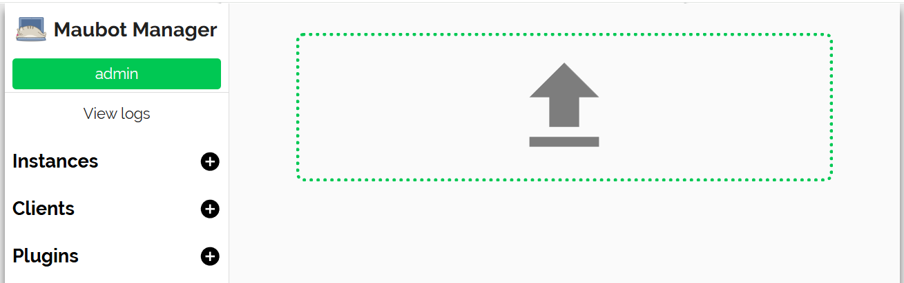
      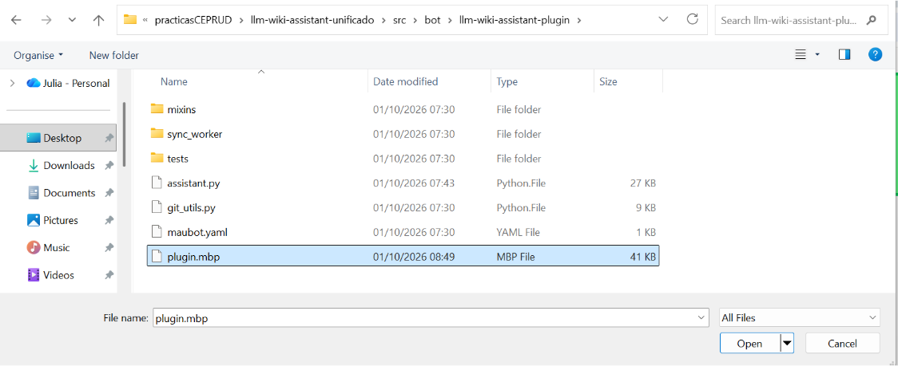
      
   - Añade el cliente conectándolo a la URL interna de Synapse (`http://synapse:8008`) usando el usuario `@llm_wiki_bot:<DOMAIN>` (el valor de `MATRIX_BOT_USER` en tu `.env`). El **access token del bot** se puede obtener del `.env` tras ejecutar `./instalar.sh`.
   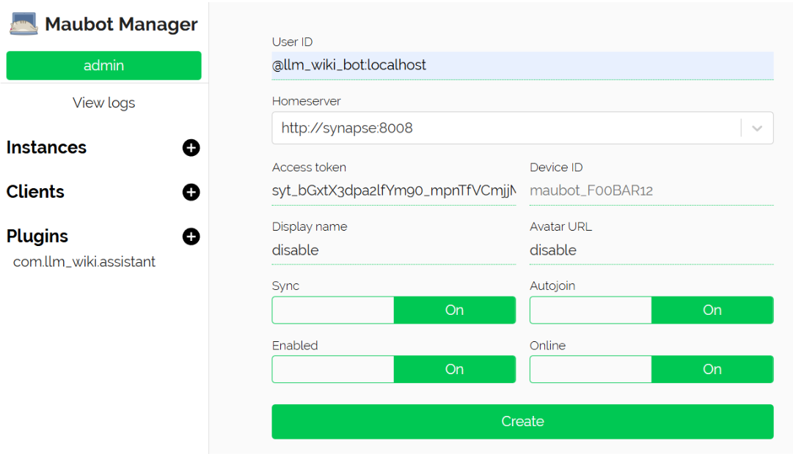
   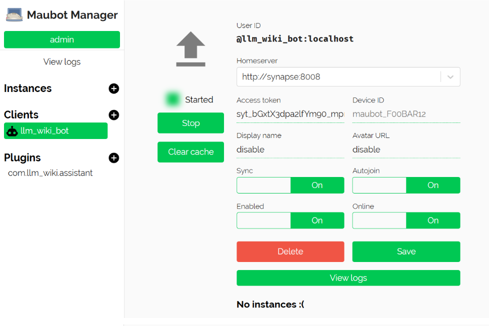
   - Crea la instancia uniendo el Cliente y el Plugin.
   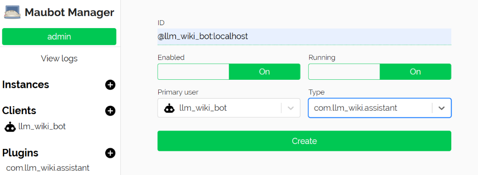
   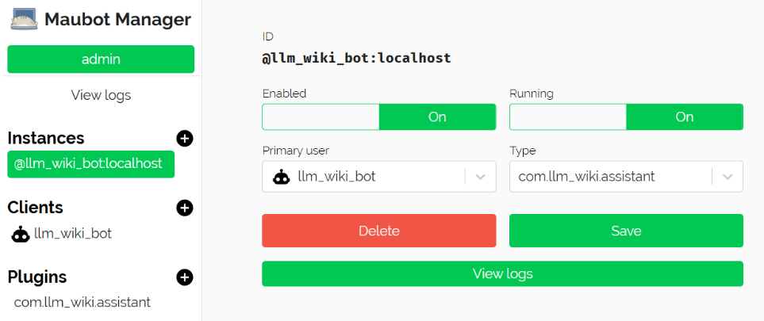

---

### Generación de Documentación (Doxygen)

La documentación se puede generar con el siguiente comando:

```bash
./instalar.sh docs serve
```

---

## Uso del Asistente (Comandos)

El bot de Matrix ofrece varios comandos para interactuar con tu base de conocimiento personal (repositorio). Escribe `!ayuda` o `!comandos` en el chat para ver la lista completa.

### Ingesta de Documentos
Hay dos formas de proporcionar apuntes al bot para que extraiga sus conceptos usando Inteligencia Artificial:

1. **Subida por chat (Recomendado):**
   Arrastra y suelta tu archivo PDF o documento de texto en la ventana del chat. El bot lo detectará automáticamente y te preguntará si quieres procesarlo (respondiendo `si` o `ocr`). Se hará también el proceso de extracción.

2. **Subida manual por Git (`!ingestar`):**
   Si prefieres subir los archivos manualmente a tu repositorio, puedes hacer un commit de tu documento dentro de la carpeta `raw/`. Tras hacer el push, ve al chat de Matrix y escribe:
   ```text
   !ingestar nombre_del_archivo.pdf
   ```
   El bot descargará el documento directamente desde GitHub y comenzará el proceso de extracción. Añade la palabra `ocr` al final si el documento contiene imágenes o escaneos.

---
